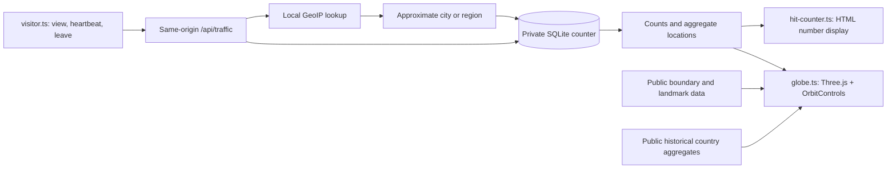

# How the homepage visitor globe was built

This describes the **visitor globe on Automate Your Network’s homepage**, extracted on November 24, 2026. The package contains its rendering code, visitor counter, approximate location lookup, map data and focused tests. It does not require access to the private website repository.

The visualization is an actual Three.js scene. Browser JavaScript records a page view and maintains a short-lived presence signal. A server stores deduplicated events in SQLite and returns aggregate counts and approximate locations. The globe polls those aggregates and updates its pins. The moving connections are decorative; they are not observed network routes or packet traffic.

## The architecture



The live website uses `server/php/traffic.php` on its Apache/PHP host. The Node implementation in `server/traffic.mjs` supplies the same kind of interface for local development and review. These are separate databases; local demo visits do not update the live website.

## Where to start reading

| File | Responsibility |
| --- | --- |
| `src/components/Network.astro` | Globe markup, controls, legends, accessible location buttons and SVG fallback. |
| `src/lib/globe.ts` | Scene construction, camera, map layers, pins, arcs, selection, animation and snapshot polling. |
| `src/components/PCGlobe.astro`, `src/lib/pc-globe.ts` | Retro SVG atlas, country profiles, visitor overlays and geographic selection. |
| `src/lib/pc-globe-audio.ts` | Optional synthesized music, with explicit playback and stop controls. |
| `src/lib/connections.ts` | Chooses illustrative pin-to-pin edges. |
| `src/lib/visitor.ts` | One page-view event per document, presence heartbeat and page-leave handling. |
| `src/components/HitCounter.astro` | Accessible HTML counter display. |
| `src/lib/hit-counter.ts` | Polls totals and animates the displayed number. |
| `src/styles/globe.css` | Only the globe/counter CSS extracted from the original shared stylesheets. |
| `server/traffic.mjs` | Local Node HTTP handler and SQLite storage. |
| `server/geolocation.mjs` | Local MMDB lookup, public-address filtering and coarse location transformation. |
| `server/php/traffic.php` | PHP/PDO SQLite implementation used by the production website. |
| `public/data/*.json`, `src/data/globe-landmarks.json` | Country/state/province outlines and city reference points. |
| `tests/traffic.test.mjs`, `tests/geolocation.test.mjs`, `tests/connections.test.mjs` | Focused counter, location and graph tests. |
| `tests/traffic-php.test.mjs` | PHP collector integration tests using temporary databases. |

`src/pages/index.astro`, `src/styles/demo.css`, `astro.config.mjs` and `package.json` are the small standalone demo shell added for this handoff. The demo uses the component’s expanded mode to expose its map and example-visitor controls; the homepage normally uses compact mode. The original website’s header, footer, articles and unrelated features are not included. The retro atlas added after the handoff is described in [docs/PC-GLOBE.md](docs/PC-GLOBE.md). The first handoff copied the core implementation unchanged. Hello, Planet subsequently adds configurable home/timezone, a zero baseline, the finished PC GLOBE visitor atlas, and standalone integration changes. The original handoff manifest is retained under `provenance/`; current code is versioned in this repository.

## Building the globe

### 1. Convert map coordinates to a sphere

`mountGlobe()` dynamically imports Three.js and `OrbitControls`, creates a perspective camera, and adds a dark sphere with cyan/pink lights and a faint outer halo. Latitude and longitude become positions on the sphere:

```ts
const latitude = lat * Math.PI / 180;
const longitude = lon * Math.PI / 180;
const point = new THREE.Vector3(
  radius * Math.cos(latitude) * Math.sin(longitude),
  radius * Math.sin(latitude),
  radius * Math.cos(latitude) * Math.cos(longitude)
);
```

The same conversion positions coastlines, administrative boundaries, reference cities and visitor pins. Small radius offsets keep overlays above the sphere’s surface. The coordinate convention places zero longitude along the positive Z axis.

The shell renders before detailed geography finishes loading. Country outlines come from `world-borders.json`. US states and Canadian provinces are separate optional layers: a failed regional-map request does not disable the rest of the globe. The supplied static map files allow ordinary builds to run without downloading geography.

### 2. Keep the different kinds of points distinct

- **Cyan pins:** aggregated approximate locations from recent collected visits.
- **Lime YOU marker:** the current request’s approximate location, when available and privacy settings permit it.
- **Pink home pin:** John’s publicly identified home municipality, not a precise address or a visitor.
- **White points:** public geographic city landmarks, with no visitor count.
- **Purple diamonds:** historical country totals, not people located at those coordinates.

The viewer’s current location is independent of the historical dataset. Changing to History does not convert an old country aggregate into a live city location. Unknown or local addresses remain unmapped.

### 3. Add orbiting, selection and illustrative connections

`OrbitControls` handles dragging and damped camera movement. Buttons provide zoom, home, geographic views and play/pause. The canvas also supports arrow keys, plus/minus and Escape. Mouse-wheel zoom becomes active when the canvas has focus so normal page scrolling still works.

A raycaster selects visible markers and city reference points. The sphere participates in hit testing, preventing a selection from passing through it to a point on the far side. Matching HTML buttons and a city selector provide alternatives to pointing at tiny objects in 3D.

`connectionPairs()` first builds a minimum spanning tree so all displayed locations connect. It adds each point’s two nearest neighbors, deduplicating edges. The user can instead connect every point to home, or turn connections off. Arcs follow a spherical interpolation with an outward lift. Small moving lights travel along those arcs. These connections express a visual relationship only; no traceroute or packet measurement drives them.

### 4. Keep rendering bounded and accessible

The renderer caps device pixel ratio at 1.6 and requests a low-power context. `ResizeObserver` maintains the canvas aspect ratio. `IntersectionObserver` and document visibility prevent scene rendering while the globe is offscreen or the tab is hidden. Reduced-motion preferences pause automatic rotation and animated flow; the user can also pause explicitly. Non-cached page exit disposes controls, geometry, materials, observers, timers and the renderer.

If WebGL is unavailable, the SVG globe and text/location controls remain. Controls start disabled until the relevant scene/map initialization completes. Status, selection and provenance remain readable HTML rather than canvas-only text.

## How visits become data

`startVisitorCounter()` checks Do Not Track, Global Privacy Control and browser automation before collecting. It uses a random session identifier in `sessionStorage` and a new random document identifier. The document identifier is reused as the page-view event ID, so retries and back/forward-cache restores cannot count the same document repeatedly.

A normal visible document sends:

1. A `view` event containing the session ID, page ID, event ID and pathname.
2. A `heartbeat` approximately every **25 seconds**, while visible.
3. A `leave` event when hidden or leaving the page. The departure request uses `keepalive`.

If the initial view was not acknowledged, the next heartbeat retries the same view event. A leave only removes presence if its page ID still matches, avoiding an old page clearing a newer page’s presence.

The server validates IDs, event types, pathname, origin, content type and body size. It hashes the session identifier with the current day before storage. SQLite maintains:

| Table | Purpose |
| --- | --- |
| `views` | Deduplicated page-view event, daily session hash, date, pathname, timestamp and optional coarse location. |
| `presence` | Latest presence timestamp and page ID for each daily session hash. |
| `counter_baseline` | Historical starting count, inserted once. |

**Active** means a session seen within the last **90 seconds**. **Today** uses `America/Toronto`. **Today’s visitors** counts distinct daily session hashes, not verified unique humans. **Total new views** counts stored page-view events. The LED-style total adds those new views to the archived baseline. Daily visitor counts must not be summed and described as unique people across days.

The globe and the counter each refresh their GET snapshot every **3 seconds**, and refresh after a successful local event. This is HTTP polling, not a WebSocket stream. Failed requests show an unavailable state or the last confirmed counter value; they do not invent activity.

## Approximate location and privacy boundaries

The server reads the directly connected IP address only for local lookup against an MMDB database. It does not send that IP to an external geolocation API. The counter database and public response do not contain raw IP addresses, browser user-agent strings, raw referrers, query strings, postal codes or precise GPS coordinates.

A usable city estimate is rounded to one decimal degree. The Node implementation requires a recognized administrative region and falls back to that region’s representative point when city data is unusable. The included production PHP implementation returns a usable rounded city estimate or leaves the visit unmapped; it does **not** implement that same region fallback. Both reject private/reserved lookup addresses and ignore arbitrary forwarded-IP headers. Behind a proxy, the trusted peer policy needs explicit integration; simply trusting `X-Forwarded-For` would change this boundary.

The optional YOU lookup is requested with `X-AYN-Viewer: 1`. DNT/GPC disable collection and viewer lookup, while aggregate/history display can still work. These are the application’s storage rules, not a claim about a hosting provider’s independent access logs. Database city estimates can be wrong, especially for VPNs and mobile carriers.

No GeoIP database, production SQLite database or visitor-event export is included in this handoff. Without a local MMDB, counting still works and locations stay unavailable. The built-in **Show example visitors** mode uses explicitly fictional in-memory pins and does not write them into the collector.

## API shape

The frontend uses one same-origin endpoint, `/api/traffic`.

```http
POST /api/traffic
Content-Type: application/json
Origin: http://127.0.0.1:4337
```

```json
{
  "type": "view",
  "session": "11111111-2222-4333-8444-555555555555",
  "page": "22222222-3333-4444-8555-666666666666",
  "event": "22222222-3333-4444-8555-666666666666",
  "path": "/"
}
```

Those IDs are illustrative. Real clients generate them with `crypto.randomUUID()`.

A GET returns `source`, `baselineViews`, `lifetimeViews`, `totalViews`, `active`, `todayViews`, `todayVisitors`, `locations`, `todayLocations` and an optional `viewerLocation`. Each location contains a stable code, display name, latitude, longitude, optional city level and aggregate `value`. `locations` counts active sessions; `todayLocations` counts page views. `lifetimeViews` must equal `baselineViews + totalViews`.

The PHP deployment rewrites `/api/traffic` to `/api/traffic.php`. SQLite and the optional MMDB/reader belong outside the document root so static releases cannot replace or expose them. See `server/php/SETUP.md` for the included production source’s configuration points.

## Run the extracted code

Use Node.js 24 or newer and npm. From the extracted package directory:

```sh
npm ci
npm run dev
```

Open **http://127.0.0.1:4337**. The dev server uses its own `private/analytics/local-preview.sqlite`. It does not contact the live website’s analytics endpoint. Browsing localhost usually cannot produce a location pin; use **Show example visitors** to inspect pins, arcs, selection and camera controls. Automated browsers deliberately do not register visits unless a test explicitly supplies synthetic events.

To build and serve the static output with the local collector:

```sh
npm run build
npm run preview
```

Stop the dev server before starting preview because both use port 4337. `npm run check` checks the Astro/TypeScript source; `npm test` runs the Node counter, location and connection tests. PHP tests are optional and require PHP 8.1+ with PDO SQLite:

```sh
npm run test:php
```

The three historical JSON files contain only the original site’s **already-public aggregate fields used by this globe**. They are sample historical content for code review, not your own site’s statistics. Their original date labels and coverage limitations are retained in the UI. No raw reports, report screenshots, individual visitor rows or tracking credentials are bundled.

## Adapt it to another website

Keep the component markup and `data-*` attributes together with `globe.ts`; the selectors are their interface. Set `document.body.dataset.visitorEndpoint` to your same-origin collector (the demo uses `/api/traffic/`, with a trailing slash for Astro dev routing) and call `startVisitorCounter()` once per document. An existing Astro application can use `Network.astro` directly. A different framework can retain the markup and call `mountGlobe(element)` after rendering; it still needs to bundle the TypeScript, Three.js and JSON imports.

Customize the home coordinate and labels, public history files, historical date copy, archived baseline, timezone and navigation destinations together. The Node baseline comes from `globe.config.json` and defaults to zero. PHP uses `HELLO_PLANET_BASELINE`, also zero by default. The sample historical total of 78,373 is separate. Both initialize their stored baseline once, so changing source alone does not reset an existing database. Decide how to migrate your own existing statistics instead of reusing the sample baseline.

The public map fetches use `/data/...` and the flag image uses `/images/...`; adjust those paths if hosting under a subdirectory. Production deployment must provide the same-origin API as well as the static files. The demo’s `/stats/` and `/about/` navigation redirects to the original public website; it does not contain those pages.

`ATTRIBUTION.md` identifies the geographic sources and included license notices. `VERIFICATION.md` records what was actually checked for this extracted package. Publishing this standalone repository does not deploy the personal website or change access to its private repository.
