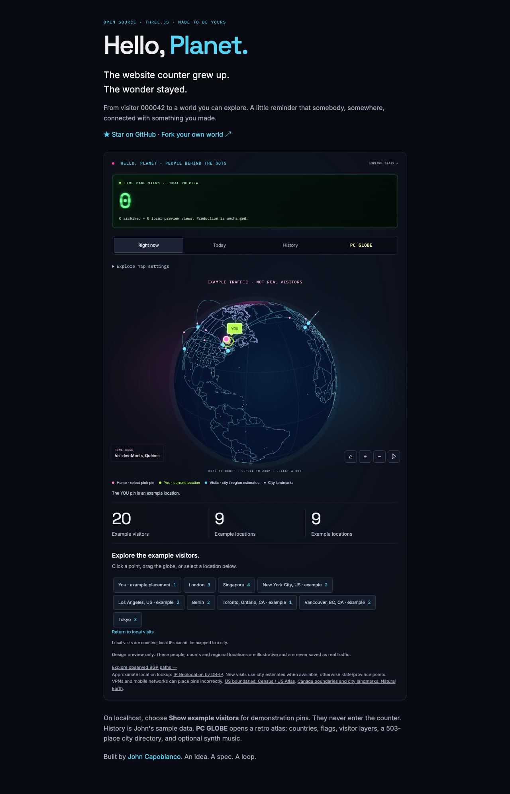
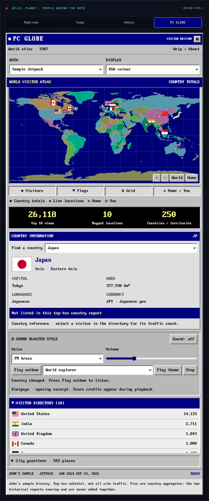

# Hello, Planet 🌍

**The website counter grew up. The wonder stayed.**

From “you are visitor 000042” to a planet you can turn, explore, and feel connected to. Hello, Planet is the Three.js visitor globe from [Automate Your Network](https://automateyournetwork.com/), extracted into a runnable, MIT-licensed project. It includes the counter, collectors, map data, and the process used to build it.



> In 1987 I was nine years old and obsessed with PC Globe. I think it deeply shaped my love of travel, culture, and humanism. In 2026, seeing people arrive at my website from places all over our shared planet gives me that feeling again. I click those places. I get curious. I am inspired to keep making things.
>
> — John Capobianco

This is why the project exists. A counter can be a small reminder that somebody, somewhere, connected with something you made. **Star it if that resonates. Fork it and make your own world.** [Explore John's live globe](https://automateyournetwork.com/stats/). [Read the announcement and personal story](https://automateyournetwork.com/ai/hello-planet/).

## Run it

Install Node.js **24 or newer**, then:

```sh
git clone https://github.com/automateyournetwork/hello-planet.git
cd hello-planet
npm ci
npm run dev
```

Open **http://127.0.0.1:4337**. Choose **Show example visitors** for fictional demonstration pins, or **PC GLOBE** to explore cities and capitals. Localhost normally has no mappable public IP. Counting works without a GeoIP database.

The new counter starts at **zero**. Example pins never become real visits. History preserves John's clearly labeled public sample aggregates, separately from your new counter. No paid service or AI key is needed to run the globe.

## What you get

| Feature | What it does |
| --- | --- |
| Three.js globe | Drag, orbit, zoom, pause, pick points, and follow illustrative arcs. |
| First-party counter | Deduplicated page views and short-lived session presence in SQLite. |
| Right now / Today / History | Separate active sessions, daily page views, and sample historical country totals. |
| PC GLOBE | Retro SVG atlas with 250 country/territory profiles and flags, visitor overlays, EGA/CGA/amber palettes, a 503-place city gazetteer, and optional sound. |
| Accessible alternatives | HTML location lists, keyboard controls, reduced motion, and no-WebGL fallback. |
| Two collectors | Node local development server and PHP/PDO SQLite implementation for compatible hosting. |
| The method | Integration instructions, migration playbook, prompt recipes, a feature spec, and verification evidence. |

Arcs are visual connections, not measured network routes. Location estimates can be wrong. “Active” means a session seen in the last 90 seconds, not a verified person online. Browser automation, DNT, and GPC skip client collection. This is an expressive personal-site counter, not fraud-resistant analytics.

## A memory became a working mode

PC GLOBE is now live on John’s site and included here. Switch from the modern 3D globe to a DOS / early Windows style atlas. Explore countries, select visitor locations, or open the city gazetteer. Choose a palette. If you want sound, play a supported anthem opening or one of two original synth themes. Audio starts only after a gesture and stops when you leave the mode.



The music collection covers 43 country/territory entries using 36 melodies, with individual source credits. Country profiles are reference data; historical totals and approximate live locations remain separate. This is an original tribute, not an emulator or a bundle of the DOS software. [Explore the design and data](docs/PC-GLOBE.md).

## Put it on your website

For an existing **Astro site**, copy the three components, supporting libraries/data, styles, public map files, and `globe.config.json`. Install the matching dependencies from this package. Then render:

```astro
---
import Network from '../components/Network.astro';
import '../styles/demo.css'; // base variables; adapt to your theme
import '../styles/globe.css';
---
<body data-visitor-endpoint="/api/traffic/">
  <Network expanded />
  <script>
    import { startVisitorCounter } from '../lib/visitor';
    startVisitorCounter(document.body.dataset.visitorEndpoint || '');
  </script>
</body>
```

Mount one tracker per document and one globe per page. In your existing layout, add the attribute and script to its body; don't nest a second body. You also need a same-origin collector at `/api/traffic`. Static hosting can display the atlas but cannot collect visitors by itself.

For **WordPress, plain HTML, React, or another framework**, use the self-hosted `/embed/` page or port the DOM contract to your framework:

```html
<iframe src="https://YOUR-GLOBE-HOST.example/embed/"
  title="Explore our visitor globe" width="100%" height="1100"
  loading="lazy" style="border:0"></iframe>
```

Replace the example hostname with your deployment. The embed is a **display only** page; it does not run a tracker. Install the tracker on your parent pages and provide a same-origin API/proxy arrangement so those pages feed the data shown in the embed. Otherwise you would count iframe loads instead of page visits. [Full integration guide](docs/INTEGRATION.md).

## Make it yours

Edit [`globe.config.json`](globe.config.json): baseline, timezone, home coordinates, name, label, and profile link. The home marker starts at John's public municipality as an example; change its flag SVG and navigation links too.

The Node collector and counter use the configured baseline. PHP uses `HELLO_PLANET_BASELINE` (default `0`) and `HELLO_PLANET_TIMEZONE` (default `America/Toronto`). Baselines initialize once: editing configuration does not rewrite an existing database. Replace or remove the sample history before representing the globe as your own site's statistics. [Configuration and deployment](docs/INTEGRATION.md).

## The secrets are the process

John's website began as a WordPress export and became an Astro site with a Three.js globe, searchable archive, books, videos, timeline, and a growing network-engineering arcade. The source evidence includes requirements, content inventories, migration checks, local reviews, and iteration notes. This repo shares the repeatable method without publishing raw backups or private access.

1. **Gather evidence.** Export your content; inventory URLs, media, and what readers depend on.
2. **Write a spec.** Describe the behavior and the checks that prove it works.
3. **Give the harness context.** Let a coding agent read the repository, run the app, and inspect a real browser.
4. **Work in a bounded loop.** Implement one coherent change, check it, look at it, fix the result, and record what remains.
5. **Review before release.** Keep the previous site recoverable and deploy only reviewed output.

Start here:

- [How the globe works](HOW-IT-WAS-BUILT.md): architecture, coordinate math, event lifecycle, API, and privacy boundaries.
- [WordPress → a site you own](docs/WORDPRESS-TO-ASTRO.md): migration playbook based on this site's rebuild.
- [Prompts and harnesses](docs/PROMPTS-AND-HARNESSES.md): copyable research, integration, build, and review prompts.
- [PC Globe mode specs](specs/002-retro-visitor-atlas.md): **An idea. A spec. A loop.**
- [Verification](VERIFICATION.md): what was tested and what wasn't.

## Where you could take it

- **Classroom atlas:** explore capitals with collection switched off.
- **Travel journal:** add places you've visited as a separate, voluntary layer.
- **Community globe:** let people opt in to a city and a story; moderate submissions.
- **Time machine:** replay coarse daily aggregates with clear dates and gaps.
- **Quieter rendering:** static mode, slower polling, and shared fetches for small devices.
- **Multilingual welcome:** greet readers in a language they choose.
- **Another backend:** implement the snapshot contract for your hosting stack.
- **Astronomy view:** put our shared planet in its larger context; label simulations.

These are ideas, not shipped features. The working PC GLOBE visitor atlas is the first example. Bring a spec, a screenshot, and a small pull request.

## Check and build

```sh
npm run check
npm test
npm run build
npx playwright install chromium
npm run test:browser
npm run preview
# Optional: PHP 8.1+ with PDO SQLite
npm run test:php
```

Stop dev before preview; both use port 4337. Node servers are local previews. Production needs a configured collector and persistent private storage outside the document root.

## Open source, with provenance

Original code and documentation: [MIT](LICENSE). Country data (ODbL), the VGA font and some anthem score data (CC BY-SA), other geographic data, flags, and dependencies retain their own terms and notices; see [ATTRIBUTION.md](ATTRIBUTION.md). No production visitor database, raw IP log, hosting backup, credential, MMDB, or private repository history is included. This is a standalone extraction, not the whole personal website. PC Globe is an inspiration; no original program or proprietary assets are bundled.

Built by [John Capobianco](https://automateyournetwork.com/about/). If this helps you see the people behind your website, **[star the repo](https://github.com/automateyournetwork/hello-planet) and [fork it](https://github.com/automateyournetwork/hello-planet/fork)**. Tell us what you build.
